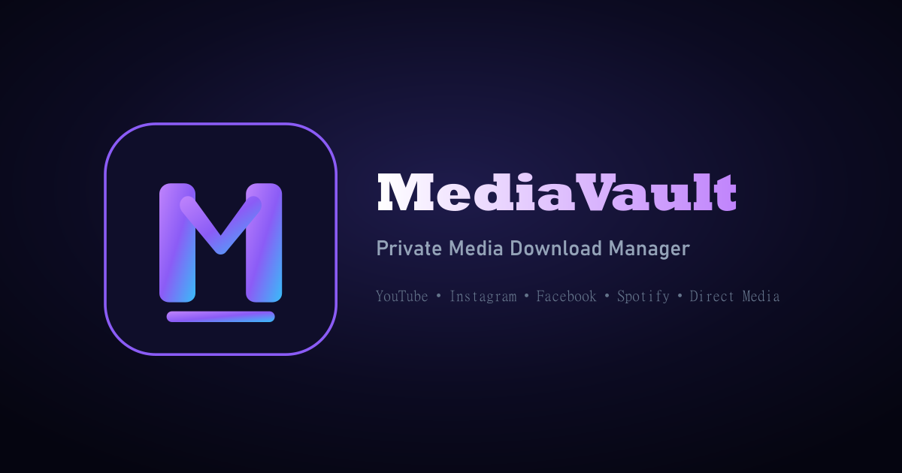

# 🔒 MediaVault — Private Media Download Manager & PWA

A modern, high-performance Progressive Web Application (PWA) designed for personal media downloading and archiving from YouTube, Instagram, Facebook, Spotify, and direct media files.



---

## 🏛️ Production Architecture: Hybrid Web & Worker

MediaVault uses a decoupled hybrid architecture that cleanly separates the serverless web presentation layer from the persistent media download engine:

```
                     USER / PHONE
                          │
                          ▼
                ┌──────────────────┐
                │  MediaVault PWA  │
                │     Netlify      │
                │                  │
                │ Next.js frontend │
                │ UI / metadata    │
                │ queue display    │
                │ settings         │
                └────────┬─────────┘
                         │
                    HTTPS (API)
                         │
                         ▼
                ┌──────────────────┐
                │ MediaVault       │
                │ Download Worker  │
                │                  │
                │ Node.js 20+      │
                │ Python 3.12+     │
                │ yt-dlp           │
                │ FFmpeg           │
                │ SpotDL           │
                │ Persistent Disk  │
                └──────────────────┘
```

1. **Local Mode (Default)**: When `MEDIAVAULT_WORKER_URL` is empty, Next.js runs the download engine, SQLite database, and binaries (`yt-dlp`, `ffmpeg`, `spotdl`) locally directly from your machine.
2. **Production Mode (Netlify + Worker)**: When `MEDIAVAULT_WORKER_URL` is set, the Netlify Next.js app acts as the user-facing web interface and securely proxies long-running download jobs to your standalone Download Worker with Bearer token authentication.

---

## ✨ Features

- 📱 **Installable PWA** — Native app experience on iOS, Android, Windows, macOS, and Linux with custom branding.
- ⚡ **Officially Supported Backends**:
  - **YouTube**: Standard videos, Shorts, progressive MP4 streams, high-definition DASH merges, and MP3 audio extraction.
  - **Instagram**: Reels, videos, and public post clips.
  - **Facebook**: Public videos, Reels, and Watch clips (`fb.watch`).
  - **Spotify**: Tracks, albums, and playlists via SpotDL.
  - **Direct Media URLs**: Instant streaming for `.mp3`, `.mp4`, `.m4a`, `.webm`, `.wav`, `.flac`, `.mov`, `.mkv`.
- 🛰️ **Resilient Real-Time Progress** — Server-Sent Events (SSE) stream live progress, transfer speeds, and ETA with automatic polling fallback.
- 🛡️ **Security & SSRF Guard** — Protected against shell injection, private network access, cloud metadata endpoints, and path traversal.
- 💾 **Authoritative File Verification** — Validates final output on disk without heuristic directory scanning or file-count guessing.
- 🐳 **Docker & Python 3.12 Ready** — Production container image with Alpine 3.20, Python 3.12, FFmpeg, and yt-dlp.

---

## 🚀 Getting Started

### 1. Local Development (All-in-One Mode)

```bash
# Clone the repository
git clone https://github.com/your-username/mediavault.git
cd mediavault

# Install dependencies
npm install

# Start Next.js development server
npm run dev
```

Open [http://localhost:3000](http://localhost:3000). Downloads will automatically save to `~/Downloads/MediaVault`.

---

### 2. Running the Standalone Download Worker

To host the download worker on a VPS, Railway, Render, Fly.io, or dedicated server:

```bash
# Start standalone worker server on port 4000
npm run worker
```

Configure your worker environment variables:
```bash
PORT=4000
MEDIAVAULT_DATA_DIR=/app/data
MEDIA_STORAGE_PATH=/app/downloads
MEDIAVAULT_WORKER_TOKEN=your-secure-secret-token-here
```

---

### 3. Running with Docker Compose

```bash
# Start containerized download worker
docker compose up -d
```

---

### 4. Deploying Frontend to Netlify

1. **Connect your repository** on [Netlify](https://app.netlify.com).
2. **Build Settings**:
   - **Build Command**: `npm run build`
   - **Publish Directory**: `.next`
3. **Environment Variables on Netlify**:
   - `MEDIAVAULT_WORKER_URL`: `https://worker.yourdomain.com` (Your deployed download worker)
   - `MEDIAVAULT_WORKER_TOKEN`: `your-secure-secret-token-here` (Must match token set on worker)
   - `NODE_VERSION`: `20`
4. **Deploy Site**.

---

## ⚙️ Environment Variables Reference

| Variable | Scope | Description | Default |
| :--- | :--- | :--- | :--- |
| `NEXT_PUBLIC_APP_NAME` | Frontend | Application display name | `MediaVault` |
| `MEDIAVAULT_WORKER_URL` | Frontend | URL of remote Download Worker | Empty (runs in local mode) |
| `MEDIAVAULT_WORKER_TOKEN` | Both | Secret bearer token between frontend and worker | Empty |
| `MEDIAVAULT_DATA_DIR` | Worker / Local | Directory for SQLite state | `~/.mediavault` |
| `MEDIA_STORAGE_PATH` | Worker / Local | Output directory for media files | `~/Downloads/MediaVault` |
| `YTDLP_PATH` | Worker / Local | Path or binary name for yt-dlp | `yt-dlp` |
| `FFMPEG_PATH` | Worker / Local | Path or binary name for FFmpeg | `ffmpeg` |
| `SPOTDL_PATH` | Worker / Local | Path or binary name for SpotDL | `spotdl` |

---

## 📜 License & Compliance

For personal, non-commercial use only. Respect platform Terms of Service and applicable copyright laws.
